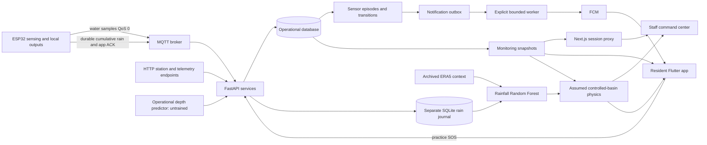

# AGAPAY end-to-end engineering and product audit

Date: October 21, 2026, Asia/Manila. Scope: current working files on `feature/day1-foundation`, based at commit `67f85e0`; substantial staged, unstaged and untracked work is present.

Follow-up: F01/F02 now have a local implementation and security regression evidence; see [authentication/provisioning rollout](../../security/F01-F02/README.md). F03/F04 now add [boot/measurement ordering and retained-message regression coverage](../../security/F03-F04/README.md). Live activation, database migration and device installation are separate, pending operations. Findings and exploit-probe results below retain the original audit snapshot; the archived exploit script intentionally expects the pre-fix behavior and is not the current regression suite.

F05/F06 follow-up: [registry source provenance and independent freshness clocks](../../security/F05-F06/README.md) now have a local backend/web/mobile implementation. Existing identities require source review, and exercise traffic has a separate namespace. This does not attest physical hardware or activate a deployment.

F07/F08 follow-up: [nullable measurements and resident exercise isolation](../../security/F07-F08/README.md) now have a local web/mobile implementation with [acceptance evidence](../../security/F07-F08/RESULTS.md). Client deployment remains pending; the original findings below are preserved.

F09–F11 follow-up: [sensor recovery policy, issuer notices and subscription-targeted delivery](../../security/F09-F11/README.md) now have a local implementation. Prototype defaults are explicitly provisional; AGAPAY App Operations is an application issuer, not an invented public evacuation authority. Live migration/configuration and physical validation remain pending.

F12–F14 follow-up (October 22): [independent channel health, measured-time rise and database-scoped analytics](../../security/F12-F14/README.md) now have a local implementation with [regression evidence](../../security/F12-F14/RESULTS.md). Coordinated rollout, the additive history index and physical validation remain pending. The findings below retain the original audit snapshot.

F15/F16 follow-up (October 22): [explicit rainfall products and reviewed installation configuration](../../security/F15-F16/README.md) now have software implementation and bench regression coverage. F16 remains physically unaccepted: no mounting/range/volume results or flashed profile were established. See the [pending physical acceptance record](../../security/F15-F16/PHYSICAL-ACCEPTANCE.md).

## Decision

**AGAPAY is an integrated development prototype with useful foundations. It is not ready to serve as an operational flood-warning or emergency-response service. Keep the core architecture and harden it in stages; a whole-system rewrite is not justified by the evidence.**

Two release blockers stand out: unauthenticated HTTP telemetry can create a critical sensor episode, and the default physical depth profile cannot reach its automatic red/buzzer threshold through accepted integer echo measurements. Older or retained data can also change current state. Improving model sophistication or polishing screens before resolving these would leave the main failure paths intact.

The desired product is a community monitoring and response platform with traceable observations, accountable human decisions, understandable resident guidance, and demonstrated operation through network and power failures. A model is one component of that product. WMO's end-to-end framework includes risk knowledge, monitoring/forecasting, communication, and preparedness/response; AGAPAY currently concentrates on monitoring and interface demonstrations. [WMO](https://public.wmo.int/all-activities/build-resilience/early-warnings-all)

## Scope and confidence

Repository root: `C:/Users/Asus/OneDrive/Documents/Agapay/Agapay`. Source references below are relative to that root and identify the file and relevant function or line. The audit covers representative implementation paths across FastAPI, SQLAlchemy, HTTP/MQTT ingestion, ESP32 firmware, Next.js/React, Flutter, alerts, notifications, practice SOS, maps, historical data preparation, rainfall regression, controlled-basin projections, CI and packaging. It is a subsystem-wide engineering review, not a claim that every line or every possible deployment configuration has been verified.

Evidence labels:

- **Reproduced:** exercised in this audit against disposable data or existing tests.
- **Source-confirmed:** behavior follows from inspected code; the associated production failure was not induced.
- **Gap:** a needed capability or evidence was not found in the inspected repository. External infrastructure or procedures might exist elsewhere.
- **Proposal:** a future product or architecture decision, not a discovered implementation bug.

The browser reached the running web sign-in at `http://127.0.0.1:3011/login` and the Flutter web sign-in at `http://127.0.0.1:8080/`. No authenticated production-account journey, native phone workflow, physical sensing, live notification receipt, external dispatch, broker ACL, cloud deployment, load test, backup restoration, or field calibration was established by that inspection. Current mobile light/dark widget previews are rendered separately with test fixtures, and are not device screenshots or field observations.

No operational database was reset or reseeded. The added adversarial probes use only an in-memory database, suppress application lifespan, mock MQTT, and disable notification transport. Existing backend tests use their designated test database. No ESP32 upload, external alert send, commit, push or application behavior change was made by this audit.

## Verification performed

| Check | Result in this audit | Evidence |
|---|---|---|
| Backend `pytest tests -q` | 240 passed; 23 warnings; 238.79 s | `backend-tests.txt` |
| Offline ML `pytest app/ml/tests -q` | 45 passed; 1 warning; 14.74 s | `ml-tests.txt` |
| Next.js TypeScript | Passed | `web-typecheck.txt` |
| Web Node checks | 18 passed | `web-tests.txt` |
| Flutter static analysis | No issues found | `flutter-analyze.txt` |
| Flutter unit/widget suite | 91 passed | `flutter-tests.txt` |
| ESP32 host logic and payload contracts | Passed with actual firmware source, host fakes and installed Zig; six telemetry payloads plus rain contracts | `firmware-host-tests-complete.txt` |
| Adversarial ingestion/state probes | Confirmed vulnerabilities and inconsistent semantics described below | `evidence-probes.json`, `evidence_probes.py` |
| Mobile visual fixtures | Seven existing theme tests passed with current light/dark captures; four captures visually inspected | `mobile-visual-fixtures.txt`, `VISUAL-REVIEW.md` |

Environment notes: sandboxed Python runs stalled without results and were stopped before host-access runs. Flutter initially could not access the installed SDK lockfile; the host-access run completed. The first firmware attempt passed C++ logic but stopped because `.venv-auth` lacked `jsonschema`; the complete rerun used existing `.venv`, which contains it. No dependency upgrade was applied. Provider warnings include a deprecated Firebase message-token API and FastAPI/Starlette TestClient APIs. These warnings deserve a tracked compatibility task, not an untested automatic SDK migration.

A production web build, ESP32 target compile/link, release APK/IPA build, fresh CI execution, vulnerability database scan and load test were not rerun. The passing local tests use already installed dependencies and local artifacts; they do not establish a clean-checkout build. Routine unit tests do not cover all the adversarial behaviors demonstrated here.

## What should be preserved

1. Server-side opaque sessions are hashed in the database; password hashing uses Argon2 through `pwdlib`. Web sessions use an HttpOnly cookie; the web proxy checks mutation origins and allowlists forwarded operations. Mobile uses secure token storage and rejects staff sessions.
2. Telemetry, alert episodes, transitions and notification intents are committed transactionally. Station locking and database uniqueness already protect important duplicate/concurrent-write cases. This is a valuable core.
3. SOS has an owner-bound idempotency reference, an exact-payload hash, durable client drafts, role checks, and compare-and-update status transitions. Preserve those behaviors as response workflows expand.
4. The rain journal persists cumulative counters before acknowledgment, rejects conflicting replay, distinguishes physical from simulated rain, and preserves uncertain recovered rainfall without inventing hourly measurements.
5. ML preparation retains provenance, quality flags and datum semantics. Rainfall regression uses causal features and chronological train/validation/test partitions with future-target boundary purges. The export has Python/browser parity checks.
6. Forecasts distinguish missing, stale, invalid, untrained and service-error states; numeric projections expire. The experimental hybrid is kept out of operational alert generation. Keep this separation.
7. Notification handling treats ambiguous delivery as `UNKNOWN` and avoids blind replay. Device revisions protect refreshed registrations. This is more careful than a simple retry-everything worker.
8. Existing light/dark infrastructure, shared controllers, dialog focus handling and tests provide a base for a coherent design system. Replace weak contracts and misleading states without discarding working UI components.

## Current system map

The graph describes code paths, not proof of a presently connected physical device. The deployment currently requires additional local files and configuration beyond the Git commit.

## Priorities and acceptance rules

P0 blocks any public or consequential operational deployment. P1 must be addressed before a supervised field pilot depends on the affected function. P2 is required to operate and maintain a professional service. P3 is a later enhancement. These are delivery priorities, not CVSS scores or claims of observed exploitation.

Effort is relative: S = a focused task; M = several coordinated changes; L = a multi-workflow feature or infrastructure project; XL = field/data/organizational work. They are not promised delivery dates.

## Findings: trusted inputs and alert semantics

### F01 — Unauthenticated telemetry can generate critical alerts

Priority: P0 | Evidence: Reproduced | Owner: Backend/security | Effort: M | Phase: 1

`agapay-backend/app/routers/telemetry.py:26` accepts POST bodies with only a database dependency. `services/telemetry_service.py:20` invokes alert processing and transactional notification enqueue. The probe submitted depth 105 cm without credentials and obtained HTTP 201, an EVACUATE episode and a durable notification event. No external message was sent.

**Change:** require a provisioned station identity, restrict it to its own station, and authenticate both HTTP and MQTT ingestion. Reserve staff credentials for administration. Add payload/rate budgets and independently protect the broker. CORS does not authenticate devices. OWASP's API controls support explicit authorization and resource limits. [OWASP API risks](https://api-security.owasp.org/editions/2023/en/0x00-header/), [resource consumption](https://api-security.owasp.org/editions/2023/en/0xa4-unrestricted-resource-consumption/)

**Acceptance:** anonymous/expired/revoked credentials and a credential for another station cannot write samples or create alert/outbox rows. Valid station traffic still works through both transports.

### F02 — Station provisioning is open to anonymous callers

Priority: P1 | Evidence: Reproduced | Owner: Backend/security | Effort: S | Phase: 1

`agapay-backend/app/routers/stations.py:26` permits anonymous station creation with caller-selected locations and thresholds. The probe obtained HTTP 201. A forged station can become a new data and alert source through F01.

**Change:** admin-only provisioning with commissioning state, verified coordinates/datum, device binding and an audit record. Decide explicitly whether read-only station/telemetry data is public; current GETs are also anonymous, which may be intentional and should be documented.

**Acceptance:** anonymous and resident writes return an authorization error; admin provisioning records actor, reason, calibration and activation state.

### F03 — An older unused sequence can overwrite current alert meaning

Priority: P1 | Evidence: Reproduced | Owner: Backend/data | Effort: M | Phase: 1

`services/telemetry_service.py:31` timestamps every accepted sample at receipt and deduplicates only an exact station/sequence pair. It does not enforce a high-water mark. In the probe, sequence 1001 at 105 cm created EVACUATE; a later arrival of sequence 1000 at 1 cm was accepted and resolved that episode to NORMAL.

**Change:** retain late samples as historical records where appropriate, but update current state only under an atomic ordering rule. Introduce device boot/session identity and measured-time semantics; do not assume arrival order equals measurement order. Preserve exact duplicate/conflicting-payload distinctions.

**Acceptance:** delayed, duplicated, rebooted and reordered messages cannot roll current measurements or episodes backward. Test concurrent HTTP/MQTT arrival as well as ordinary sequential requests.

### F04 — Retained MQTT water samples can appear freshly measured

Priority: P1 | Evidence: Reproduced | Owner: Backend/IoT | Effort: S | Phase: 1

`services/mqtt_subscriber.py` rejects retained rain snapshots but does not reject retained telemetry. A mocked retained telemetry message with an unseen sequence was persisted with a new receipt timestamp. A subscriber reconnect could therefore make an old broker-retained sample look current.

**Change:** reject retained operational water telemetry or ingest it strictly as historical/untrusted-for-current-state. Define an envelope with measured time, device uptime, boot ID, schema/config version and source identity.

**Acceptance:** a retained sample cannot advance `last_ping`, restore LIVE status or transition an alert. Include first-subscription and reconnect tests.

### F05 — Physical-device provenance is inferred from a client-controlled string

Priority: P1 | Evidence: Reproduced | Owner: Backend/security | Effort: M | Phase: 1

`services/monitoring_service.py:74` calls a source `simulator` when the latest firmware-version string contains that word and otherwise calls it `device`. The probe's HTTP payload with `1.0.0` became `device`, without hardware evidence. Topic/payload station matching is useful but does not establish sender identity.

**Change:** persist trusted ingress identity and an explicit source class assigned by the authenticated gateway/device registry. Store firmware version separately. Separate exercise and operational streams or namespaces.

**Acceptance:** HTTP simulators and arbitrary publishers cannot claim physical provenance by changing a firmware string. Hybrid sensor initialization accepts only a trusted physical source.

### F06 — Heartbeat age and last-valid measurement age are conflated

Priority: P1 | Evidence: Reproduced | Owner: Backend/contracts | Effort: M | Phase: 1

`monitoring_service.py:110` returns the latest valid depth from the bounded history, while `observed_at` at line 117 belongs to the latest sample, which may be invalid. The probe returned a one-hour-old valid depth with `age_seconds=0`, `connection=online`, a fresh `observed_at`, and `sensor_quality=invalid`. Clients partly guard this, but the API cannot accurately date the retained value. Once the valid sample falls outside the requested history length, that value can disappear without a real recovery.

**Change:** expose heartbeat time, latest-sample time, last-valid-depth time, quality and per-channel freshness separately. Query the last valid observation independently of chart window length. Define whether an active historical hazard is unresolved versus currently observed.

**Acceptance:** invalid heartbeats keep device connectivity separate from measurement freshness; web, mobile, maps, reports and model initialization show the same true age of the retained measurement.

### F07 — Missing measurements are converted to numerical zero in the web model

Priority: P1 | Evidence: Source-confirmed | Owner: Web/contracts | Effort: M | Phase: 1

`agapay-web/src/context/MonitoringContext.tsx:40` maps null depth and rainfall to zero. `data/mockData.ts` requires numeric fields. Some screens check UNKNOWN, but statistics, comparison bars and reports consume these numbers directly. A no-data station can consequently contribute a fabricated 0 cm or 0 mm.

**Change:** use nullable measurement objects throughout; display an em dash and explicit reason. Exclude unavailable samples from extrema and aggregate statistics, with a coverage count. Retained historical values need their own timestamp and quality state.

**Acceptance:** no data, valid zero, stale nonzero and invalid data produce four distinct presentations and correct aggregates on every screen and export.

### F08 — Resident home falls back to simulated warning values

Priority: P1 | Evidence: Source-confirmed | Owner: Mobile/product | Effort: M | Phase: 1

`agapay-mobile/lib/screens/home/home_screen.dart:15` uses `level.water` when no valid measurement exists; `AppController.alert` starts as warning. `models/alert_level.dart` embeds example depths, rates, rainfall and trends. The source label identifies DEMO/WAITING and a simulation control exists, but the main hazard card and gauge still display example warning content in the ordinary signed-in journey. This is especially confusing during startup and API outages.

**Change:** give operational home a true unknown state with last-known data where available. Move simulation into a deliberately entered exercise workspace with persistent labeling; never auto-enter it because a feed failed. Replace the hardcoded San Vicente home heading with the actual profile/selected-station context.

**Acceptance:** a new account, empty station, login delay and failed API never invent a hazard, depth, rainfall or rate. Exercise mode is explicit and cannot mutate operational state.

### F09 — Single-sample thresholds produce noisy episodes

Priority: P1 | Evidence: Reproduced | Owner: Backend/hazard domain | Effort: M | Phase: 1

`services/alert_service.py` immediately transitions on each valid threshold crossing. Probe values 59.9, 60.1, 59.9, 60.1 cm created two advisory episodes. Repeated borderline readings can create alert fatigue; a single lower reading can resolve a serious episode.

**Change:** agree on station-specific hysteresis, recovery persistence, plausibility checks and an audited manual review/escalation policy with domain operators. Preserve immediate critical escalation when required; a generic delay for every severity would introduce a different risk. Threshold values and persistence rules need physical validation.

**Acceptance:** realistic sensor noise does not chatter; sustained recovery resolves correctly; a genuine rapid rise is not suppressed; invalid readings never imply recovery.

### F10 — Sensor tiers are sometimes phrased as official evacuation authority

Priority: P1 | Evidence: Source-confirmed | Owner: Product/domain | Effort: S | Phase: 1

`agapay-web/src/components/CommunityAlertThresholds.tsx:7` says “Mandatory evacuation”; its normal tier says “Safe, routine flow.” Mobile guidance is more cautious and refers to local-authority instructions. A local threshold or missing hazard is not proof of community safety or an authorized evacuation order.

**Change:** define separate observation tier, forecast risk, official advisory and authority-issued action message. Use consistent copy and display issuing authority, area, effective time and expiry for official notices. CAP provides a useful exchange model for status, urgency, severity, certainty, updates and cancellations. [OASIS CAP 1.2](https://docs.oasis-open.org/emergency/cap/v1.2/CAP-v1.2-os.pdf)

**Acceptance:** sensor and experimental states cannot appear as an official order. All official notices identify their issuer and lifecycle, including correction/cancellation.

### F11 — Notifications are broadcast to every eligible resident device

Priority: P1 | Evidence: Source-confirmed | Owner: Backend/product | Effort: L | Phase: 1

`services/notification_service.py:18` and `:52` select all active resident registrations; no station, barangay or affected-area predicate exists. Mobile profile describes the barangay as being used for targeted alerts. Citywide visibility of sensor episodes can be deliberate, but that is different from targeted notification delivery.

**Change:** introduce explicit station/area subscriptions, verified geographic identifiers and a citywide override with authority and reason. Model staff jurisdiction separately from public alert visibility. Do not infer flood exposure solely from nearest-station distance or a free-text barangay.

**Acceptance:** ordinary station escalation reaches only intended subscriptions/areas; citywide actions are explicit and audited; changing a local UI label cannot silently change operational targeting.

### F12 — System Health reports rain health using water-station connectivity

Priority: P1 | Evidence: Source-confirmed | Owner: Web/contracts | Effort: S | Phase: 1

`agapay-web/src/components/SystemHealth.tsx` labels the rain gauge Active whenever `st.isOnline` is true. It does not consult the independent rain journal. It also collapses no-data, maintenance and inactive into offline counts. A good water heartbeat cannot prove a working rain gauge.

**Change:** a channel health contract should independently report water sensor, rain counter, device heartbeat, broker ingestion and calibration state. Preserve administrative state as another dimension.

**Acceptance:** disconnecting only the rain feed changes rain health; a maintenance station is not counted as an unexpected outage; zero rain remains distinguishable from unknown rain.

### F13 — Rise classifications ignore elapsed measurement time

Priority: P2 | Evidence: Source-confirmed | Owner: Backend/data | Effort: M | Phase: 2

`monitoring_service.py:19` compares the last two valid depths with fixed 0.5/4 cm thresholds but does not divide by elapsed time. A 4 cm change over two seconds and over twenty minutes receive the same rapid-rise label. F03 and F06 further weaken this interpretation.

**Change:** calculate a robust rate in cm/minute over a bounded valid-time window, with uncertainty and minimum coverage; label trend unknown when timing/coverage is insufficient. Do not substitute the example rates in mobile `AlertLevel`.

**Acceptance:** equivalent physical rates at different sampling frequencies produce consistent trends; gaps and invalid observations do not manufacture stability.

### F14 — Analytics aligns stations by row position and bridges gaps

Priority: P1 | Evidence: Source-confirmed | Owner: Web/data | Effort: M | Phase: 1

`components/Analytics.tsx:20` chooses one station's time label for a shared array index and assigns other stations' values at that index. Asynchronous streams can therefore appear simultaneous. The line chart uses `connectNulls`. Time-period controls are disabled for actual data, and the report covers only recent samples from the monitoring window, not a persisted flood-event time range.

**Change:** build a timestamp-keyed series with explicit aggregation/resampling policy and gaps. Add a bounded backend history/report query with timezone, coverage, event ID and station filters. Export exactly the selected scope with units, quality and source metadata.

**Acceptance:** two stations sampled at different times cannot be falsely aligned; outages remain gaps; exported maxima and event intervals match database records. A CSV report must not imply a 24-hour analysis when only minutes of samples were loaded.

### F15 — Legacy rainfall values have no explicit interval contract

Priority: P1 | Evidence: Source-confirmed | Owner: Backend/IoT/contracts | Effort: M | Phase: 1

`TelemetryCreate` has `rainfall_mm` without interval start/end; `PredictionSample.rainfall_interval_seconds` correctly defaults to unknown. Analytics calls the field rain “per latest interval,” while the newer rain journal independently provides completed-hour and current-hour values. Having two rainfall representations makes accidental unit/time misuse easy.

**Change:** version the telemetry envelope and record an explicit rainfall interval, quality, count and calibration version. Make the durable rain journal's defined products authoritative for rainfall panels; deprecate ambiguous quantities. Never fabricate hourly inputs by summing overlapping cumulative snapshots.

**Acceptance:** all rainfall displays and features identify interval boundaries, source and missing coverage; firmware/API/client contract tests verify conservation, resets and outage recovery.

## Findings: workflows, clients and operational response

### F16 — The default physical depth alarm cannot reach its critical threshold

Priority: P0 | Evidence: Reproduced | Owner: IoT/domain | Effort: L | Phase: 1

Firmware hardcodes mounting height 120 cm, minimum valid distance 20 cm and critical depth 100 cm (`src/main.cpp:35`). Critical therefore requires distance exactly 20 cm. But `pulseIn` reports integer microseconds: 1167 us gives approximately 20.01405 cm, depth 99.98595 cm, still WARNING; 1166 us gives 19.9969 cm and is rejected. With these defaults the acquisition path cannot reach EVACUATE. The existing host test `tests/firmware_host_test.cpp:245` explicitly asserts this boundary and passed in this audit. Invalid readings retain previous local outputs, so moving straight into the blind zone is not an escalation strategy.

This is a known development limitation documented in `agapay-firmware/docs/local-alert-finalization-2026-10-13.md`, not a newly claimed physical observation. The separate cardboard-demo profile uses local distance zones and can activate red/buzzer at 25 cm, while reporting depth 95 cm, which the backend classifies WARNING. No currently flashed profile was identified in this audit. A software-controlled output demonstration does not resolve physical range/calibration.

There is also configuration drift risk: backend stations allow different mounting/threshold values without a device configuration handshake; mobile `AlertLevel.forWater` embeds defaults; ML Configuration displays 0.70 mm/tip for every selected station. STATION_001's 0.70 mm/tip is the existing configured value, not new field calibration evidence.

**Change:** establish physically justified mounting/range/threshold geometry with a reliable margin through the entire warning range; do not simply lower a life-safety threshold to make the buzzer sound. Define and validate the blind-zone fault policy. Create a versioned commissioning/calibration record: datum, installation height, sensor range, uncertainty, thresholds, rain coefficient, reviewer and effective time. Devices report the applied config hash; local fail-safe rules remain available offline. Show disagreements rather than silently using different thresholds.

**Acceptance:** the real acquisition path crosses every approved tier with measured range margin; blind-zone/invalid measurements follow the reviewed fault policy; differing device/server configurations are visible; each station displays its own coefficient; controlled volume and range tests are recorded before field claims. Cardboard bench output tests remain separately labeled.

### F17 — Station lifecycle administration is incomplete and inconsistent

Priority: P1 | Evidence: Reproduced | Owner: Backend/operations | Effort: M | Phase: 1

The station router exposes create/read but no managed update/commission/decommission workflow. Rain ingestion checks active status; water ingestion does not. The in-memory probe placed a station in maintenance, submitted high water telemetry, and created a new active EVACUATE episode. The correct maintenance policy may include hazard monitoring, so the defect is an undefined/inconsistent contract, not automatically that all such samples should be discarded.

**Change:** explicitly model ingestion, observation visibility, local alarms and external notifications during maintenance; do not silently erase existing incidents. Add audited metadata/configuration updates and commissioning validation.

**Acceptance:** each lifecycle state has documented behavior across water, rain, UI and notifications; configuration writes require authorization and conflict protection.

### F18 — Profile switches do not consistently represent real capabilities

Priority: P2 | Evidence: Source-confirmed | Owner: Mobile/product | Effort: M | Phase: 2

Mobile `profile_screen.dart:182` discloses that Flood Alerts is only a future preference, but still renders an operative switch. Location Services reflects an in-memory preference rather than current OS permission; it does gate GPS entry points, but “Allowed” can be inaccurate. `AppController.updateSettings` does not persist these preferences. Theme persistence, in contrast, is implemented.

**Change:** persist actual product preferences; bind notifications to a documented preference and permission model; display OS permission, service availability and application choice separately. Label unavailable capabilities as unavailable instead of offering an inert control.

**Acceptance:** preferences survive restart; turning a delivery preference off has the stated effect, subject to clearly defined official-critical-alert rules; displayed location permission matches the OS.

### F19 — Language and geographic context are inconsistent

Priority: P2 | Evidence: Source-confirmed | Owner: Product/mobile/web | Effort: L | Phase: 2

The mobile language link changes English/Filipino text in a settings value without a localization layer for the rest of the app. Web correctly explains that Filipino translation is unavailable. Mobile home hardcodes “San Vicente, Urdaneta”; account barangay and station metadata can differ. Version labels also disagree (`pubspec` 0.1.0, profile 1.0.0 / Build 2024.001 / copyright 2024).

**Change:** introduce real locale resources and reviewed hazard-message translations, stable geographic IDs, selected-area context, and build-generated version information. Ask community users which additional local language is useful rather than assuming one.

**Acceptance:** changing language updates full critical flows; no partial untranslated emergency instruction remains; selected station and resident location are clearly distinct and correctly named.

### F20 — Identity lifecycle and abuse protection need operational completion

Priority: P2 | Evidence: Gap | Owner: Security/accounts | Effort: L | Phase: 2

The mobile Forgot password link opens a preview notice; web Google sign-in opens an unconfigured-provider notice. No verified contact recovery or privileged MFA flow was found. The bounded auth limiter is process-local; the Next.js proxy also concentrates web client requests behind one backend peer. This is documented in the limiter but not solved by scaling workers.

**Change:** implement verified recovery/invitation flows, staff MFA, session/device management, a shared abuse-control strategy and carefully trusted proxy identity. Hide unconfigured sign-in options. Require deliberate environment/bootstrap configuration at deployment rather than relying on development defaults.

**Acceptance:** recovery tokens expire and are single-use; staff access is recoverable and auditable; limits behave consistently across workers and do not lock out an office behind a shared proxy by accident.

### F21 — Administrative mutations lack a general audit and version contract

Priority: P1 | Evidence: Source-confirmed | Owner: Backend/security | Effort: M | Phase: 1

`routers/users.py` edits records and revokes relevant sessions, but profile/administrative edits do not require an expected record version or write a general actor/reason/before-after audit trail. `updated_at` exists but is not a stale-write precondition. Existing alert transitions and SOS status records are useful domain histories, not coverage of all configuration and account changes.

**Change:** add explicit versions, atomic compare-and-update, reasons for privileged changes, and append-only audit events with redaction. Return 409 with refreshed values and require manual review; never automatically retry a stale mutation over newer data.

**Acceptance:** two editors cannot silently overwrite each other; role/activation/threshold changes identify actor and reason; audit records never contain passwords or full push tokens.

### F22 — SOS location updates have a concurrency race

Priority: P1 | Evidence: Source-confirmed | Owner: Backend/SOS | Effort: M | Phase: 1

`routers/sos.py:79` reads the previous capture time and unresolved status, compares in Python, then writes by ORM commit. Unlike SOS status transitions at line 134, it does not include those conditions in an atomic update. Concurrent fixes can both pass the read and let an older fix win; a concurrent resolution can race the location write. The interleaving was identified in code, not reproduced against PostgreSQL in this audit.

**Change:** conditional update or row lock covering owner, expected version, lifecycle and capture time. Keep exact duplicate-fix idempotency and reject equal-time conflicts.

**Acceptance:** real-engine concurrency tests show newer location survives, resolved requests stop accepting fixes, and losing writes return an explicit refresh-required conflict.

### F23 — Practice SOS is not an operational response workflow

Priority: P1 | Evidence: Source-confirmed | Owner: Product/response operations | Effort: XL | Phase: 2

SOS records are deliberately `practice=True`, and the lifecycle is ACTIVE → ACKNOWLEDGED → RESOLVED. This is honest prototype behavior. No dispatch integration, responder assignment, response SLA, handoff, arrival, escalation or duty roster was found. Acknowledgement must not be interpreted as a responder being sent.

**Change:** first agree on the actual LGU workflow, operators, hours and fallback contacts. Then implement assignment, contact attempts, accepted dispatch, arrival, closure reasons, timed escalation and resident-visible status. Keep exercises segregated. Introduce incident correlation without losing individual resident requests.

**Acceptance:** a drill demonstrates ownership and escalation when the first officer is unavailable; every displayed response status has a real recorded action behind it. Operational mode is enabled only after those procedures are agreed and tested.

### F24 — Shelter and route information is a demonstration-sized model

Priority: P1 | Evidence: Source-confirmed | Owner: Maps/response operations | Effort: L | Phase: 2

`map_screen.dart:25` uses a single hardcoded UCU Gym destination. The code appropriately asks users to confirm shelter activation and retains route warnings; there is no managed shelter inventory, capacity, accessibility, activation time or flood-road-closure source. Generic walking directions do not establish flood-safe access.

**Change:** an authority-maintained shelter registry with verification/expiry, capacity, services and access constraints; route warnings and blocked-road overlays; a usable text/list fallback when Maps fails. Avoid labeling a computed route safe without current evidence.

**Acceptance:** inactive/full/unverified shelters are clearly distinguished; map quota, GPS denial and route failure leave usable verified instructions and contacts. Shelter updates show source and freshness.

### F25 — Offline behavior is insufficient for a community response product

Priority: P1 | Evidence: Gap | Owner: Mobile/backend/product | Effort: L | Phase: 2

Durable SOS drafts exist, but monitoring/alerts rely mainly on live polling and process memory. There is no general persistent last-known station/official-advisory cache or durable reader state. API timeouts can preserve some current-screen values, but a cold offline launch and a lost response need explicit product behavior.

**Change:** an encrypted local cache with original timestamps, stale labels and bounded retention; approved offline preparedness/contact content; a durable, user-visible SOS outbox using the existing exact-payload idempotency rules. Never label a queued request received or automatically overwrite a server-side conflict.

**Acceptance:** airplane-mode cold launch, interrupted send, restart and reconnect preserve accurate received/queued/unknown distinctions. Users can inspect what remains unsent; no duplicate SOS or fabricated “live” reading appears.

### F26 — Mobile maps use a second monitoring store with weaker freshness handling

Priority: P1 | Evidence: Source-confirmed | Owner: Mobile/contracts | Effort: M | Phase: 1

`map_screen.dart:113` fetches and parses its own station snapshot on a five-second timer, stores raw `is_online`, and retains it on request failure. Home uses `MonitoringController.isFresh`, which ages values and considers errors. The map's retained markers can therefore disagree with home during outages or overlapping refreshes. Station selection is shared, but measurement state is duplicated.

**Change:** use the shared monitoring controller and an immutable per-channel freshness view on both screens; guard request generations and invalidate expired markers without waiting for a successful network response.

**Acceptance:** one disconnect, station switch, account switch and late response yield identical freshness/source/quality on home, map, detail and forecast.

## Findings: infrastructure, reliability and delivery

### F27 — Device transport is unsuitable for an exposed production network

Priority: P1 | Evidence: Source-confirmed | Owner: IoT/security/infrastructure | Effort: L | Phase: 2

Firmware uses `WiFiClient` (`main.cpp:97`) and a local TCP MQTT topology; backend TLS defaults false. Mobile correctly refuses insecure native release API URLs, but the available development endpoints are loopback/emulator HTTP. A functioning local demo is not evidence of an encrypted, authenticated field deployment.

**Change:** validated TLS, per-device broker ACLs, credential provisioning/rotation/revocation, a production HTTPS API origin, protected secret injection and separate environments. Broker configuration must be inspected in the actual deployment; its current external security was not assessed here. Add a restrictive web security-header/CSP policy compatible with Maps and the theme script, with rollout validation.

**Acceptance:** wrong station, revoked credential, untrusted certificate and unauthorized topic operations fail; traffic confidentiality is verified on the intended deployment; development exceptions cannot enter release builds.

### F28 — Water telemetry is latest-only and loses outage history

Priority: P1 | Evidence: Source-confirmed | Owner: Firmware/ingestion | Effort: L | Phase: 2

Firmware `main.cpp:969` uses a one-item telemetry queue, `xQueueOverwrite`, QoS 0 publication and deliberate stale/offline interval dropping. That is a clear bounded-resource design for a demo, and local sensing remains independent. It cannot provide a recoverable depth history through an extended outage. Rain uses a stronger durable cumulative/ACK model.

**Change:** specify the needed history and power budget, then add a bounded durable depth buffer or gateway journal with measured time, boot/sequence identity and application acknowledgments. Backfilled observations must not be treated as new hazards simply because they arrive later.

**Acceptance:** a controlled outage/reboot retains the agreed history, reports gaps honestly, drains within resource limits, does not replay alerts, and leaves local fail-safe sensing responsive.

### F29 — Schema evolution and production startup are not managed

Priority: P1 | Evidence: Source-confirmed | Owner: Backend/infrastructure | Effort: M | Phase: 1

`app/main.py:22` uses `Base.metadata.create_all` and automatically runs `seed_demo_station`; no versioned migration system was found. `create_all` does not evolve existing table columns. The seed can update legacy demo metadata. Default development configuration selects SQLite and enables local administrator setup and hybrid demonstrations. The Dockerfile runs a single API process without a managed external database/worker deployment definition.

**Change:** add ordered, reviewed, data-preserving migrations and a separate explicit demo bootstrap. Validate production settings at startup. Choose a managed PostgreSQL deployment when multi-user operation and recovery requirements justify it; adopt it through migration/restore testing, not a data reset.

**Acceptance:** a copy of the current database upgrades without losing accounts, alert history, SOS or outbox state; migration/version mismatch blocks readiness; production startup never inserts demo records automatically.

### F30 — Health checks do not report whether the service can perform its job

Priority: P1 | Evidence: Gap | Owner: Infrastructure/backend | Effort: M | Phase: 1

`routers/health.py` performs `SELECT 1`; the web System Health screen mostly reports station states. There is no inspected readiness view for broker subscription, ingress lag, worker liveness, rain-journal writes, model-artifact availability, queue age or stalled deliveries. Log output exists, but no cross-flow correlation/metrics/alerting configuration was found.

**Change:** separate liveness, readiness and dependency diagnostics. Add structured correlation IDs, ingestion/decision/delivery latency metrics, error budgets and an on-call runbook. Monitor the user-visible workflow rather than equating HTTP 200 with operational readiness.

**Acceptance:** stop the worker, break broker authentication, remove an artifact, fill storage and interrupt a dependency in a test environment; each fault produces a specific operator alert and accurate user-facing degraded state.

### F31 — Global rapid polling recomputes too much work per viewer

Priority: P2 | Evidence: Source-confirmed | Owner: Backend/web/mobile | Effort: L | Phase: 2

Web monitoring polls every second, hybrid projection approximately every 750 ms after completion, and SOS every five seconds. These providers are mounted around all command pages. Each protected web call performs a proxy authentication lookup in addition to endpoint authentication. Monitoring queries recent history per station; a sensor-based hybrid request calls the all-station snapshot even for one station. Mobile hybrid polls every 1.5 seconds, plus monitoring/alerts/map timers. A complete pause/resume strategy was not found for these feeds; SOS does have lifecycle handling.

**Change:** a server-produced read model, bounded per-station queries, freshness-aware caching, coalesced subscriptions and SSE or another measured push approach where it helps. Retain a bounded reconnect/poll fallback. Compute shared inference once per input/config version, rather than once per viewer.

**Acceptance:** measure CPU, query count, response bytes, battery/network use and p95/p99 end-to-end lag at agreed station/viewer counts; degrade gracefully when a client background/resumes. A push connection is not itself a guarantee of delivery or freshness.

### F32 — Rain journal reads and raw event growth will become expensive

Priority: P2 | Evidence: Source-confirmed | Owner: Backend/data operations | Effort: M | Phase: 2

`RainGaugeStore.__init__` runs schema/WAL setup on each newly constructed instance; callers construct it repeatedly. `snapshot` scans recent raw events, every historical gap, lifetime totals and anchor sums. Only the uniqueness/primary-key indexes are declared. A quiet five-second heartbeat is about 17,280 raw journal events per day per station; two-second water samples are about 43,200/day. These are arithmetic estimates, not measured capacity results.

**Change:** initialize schema once, add query-plan-driven indexes and incremental hourly/lifetime summaries; archive raw data under a retention policy with integrity checks. Keep uncertain recovery and source/calibration boundaries explicit. Consider moving the journal to a managed store only after specifying its durability and transaction guarantees.

**Acceptance:** long-history query benchmarks remain bounded at the agreed retention horizon; hourly totals and missingness reproduce the original journal; crash/restart and backup restore preserve ACK semantics.

### F33 — Notification transport needs operator visibility and receipt evidence

Priority: P1 | Evidence: Gap | Owner: Backend/mobile/operations | Effort: L | Phase: 2

The transactional outbox and no-blind-replay policy are strengths. However, `notification_worker.py` runs an explicit one-batch command; no supervised continuous deployment was found. `PROCESSING` rows deliberately cannot be automatically reclaimed, and `UNKNOWN` needs reconciliation. No authenticated operator delivery console or app-level receive/open/acknowledge receipt flow was found. FCM acceptance and device receipt are different events. [Firebase delivery documentation](https://firebase.google.com/docs/cloud-messaging/understand-delivery)

**Change:** supervise and monitor workers; add a reconciliation console with audited decisions, queue-age thresholds, expiry and delivery-stage evidence. Define fallback channels and consent/recipient rules. Keep `UNKNOWN` ambiguous until evidence resolves it; do not bulk reset it to pending.

**Acceptance:** a controlled phone test distinguishes queued, provider accepted, app received, opened and user acknowledged where instrumented. Killing a worker at each send boundary does not cause an automatic duplicate or a silently stuck incident.

## Findings: ML/AI, design and release engineering

### F34 — The operational water-depth predictor is not trained

Priority: P1 | Evidence: Source-confirmed | Owner: ML/domain | Effort: XL | Phase: 3

`services/ml_predictor.py:41` returns `UntrainedPredictor`; the original `model.h5`, `scaler.pkl` and training file are placeholders. The hybrid model predicts rainfall from archived ERA5, then applies controlled-basin physics with assumed parameters. No reviewed paired field water-depth targets or real-world depth validation were found. This boundary is correctly disclosed in code and recent UI; it remains a central product-readiness gap.

**Change:** decide the actual forecast target and datum for each site; collect quality-reviewed paired rainfall/water observations, calibration history and deployment-time data availability. Start with persistence and rate/trend baselines. Keep the current experimental path isolated until an independently evaluated operational adapter is approved.

**Acceptance:** a model card identifies target, units, site, datum, data licenses, training cutoff, features actually available at inference, allowed use, error profile and fallback. A withheld set of real events demonstrates value over the agreed baseline.

### F35 — Web and mobile can show different projections for the same station

Priority: P1 | Evidence: Source-confirmed | Owner: Backend/contracts/web/mobile | Effort: L | Phase: 1

Web hybrid settings are per-account/browser local storage, with manual/historical/live options and arbitrary basin parameters. Mobile `/summary` builds a separate fixed server-owned assumed-basin request (`routers/hybrid_projections.py:61`). That separation is intentional, but it means staff and resident numbers are not necessarily the same published forecast. The evaluation page independently hardcodes one artifact version at `ml-evaluation/page.tsx:8`, while backend settings choose a model directory.

**Change:** persist a reviewed station configuration/version and publish a single forecast product with forecast ID, data cutoff, model/config version, measurement source, generation time and expiry. Put private experiments in a visibly separate workspace. Have evaluation read the deployed registry rather than a separate filesystem constant. Add explicit Pydantic response schemas for hybrid outputs and generate or validate TypeScript/Dart contracts from OpenAPI.

**Acceptance:** web and mobile opening the same forecast ID agree on all values and metadata; a private experiment cannot change residents' official view; an artifact switch updates evaluation and inference together. Production intentionally returns either an approved product or a clear unavailable state, not a development-only endpoint masquerading as available functionality.

### F36 — Evaluation does not yet quantify field decision uncertainty

Priority: P1 | Evidence: Gap | Owner: ML/domain/product | Effort: XL | Phase: 3

Saved rainfall scores show retrospective skill, not flood-warning quality. There are no field-depth intervals, peak-error distributions, event detection/missed-event results, warning lead-time distributions, subgroup/site performance or drift thresholds. Current depth projections show three decimal places despite assumed basin dimensions, which overstates useful precision. The current evaluation UI already discloses that first-hour persistence has lower MAE; preserve that honesty.

**Change:** evaluate by horizon, storm/event, extreme intensity, season, site and missing-data regime; use blocked/event-based uncertainty estimates for serially correlated data. Establish candidate-versus-baseline release criteria, calibrated prediction intervals, out-of-distribution detection, drift monitoring and rollback. Align displayed precision with validated sensor/model uncertainty. NIST's AI RMF is a useful lifecycle framework, not a certification. [NIST AI RMF](https://www.nist.gov/itl/ai-risk-management-framework)

**Acceptance:** agreed false-alarm/miss and lead-time tradeoffs are measured on withheld events; uncertainty coverage and fallback behavior are validated; no pooled mean score is presented as flood accuracy.

### F37 — Local success does not reproduce the new feature set in clean CI/deployment

Priority: P1 | Evidence: Source-confirmed | Owner: CI/backend/web | Effort: M | Phase: 1

`.github/workflows/ci.yml:37` installs `requirements-dev.txt`, which includes core requirements and pytest but not the ML/hybrid requirements. Newly added ML tests import pandas/scikit-learn, and `tests/test_hybrid_dashboard.py:20` depends on specific artifacts under ignored `data/`. The Dockerfile copies core requirements and `app/`, not those model/data artifacts or optional runtime dependencies. Web evaluation reads sibling `data/models`; generated offline demo assets are also ignored. The 18 web checks are not invoked by the web CI job. Much of the relevant code is currently untracked, so these are integration risks in the working tree, not a claim that the last pushed CI failed.

**Change:** separate core, offline ML and hybrid integration jobs with explicit dependency sets; use small synthetic CI fixtures instead of requiring a developer's private training dataset. Package approved artifacts through an integrity-checked registry/build stage with licensing controls. Invoke web checks and meaningful browser workflows in CI. Add dependency/security scanning and validate from a fresh checkout.

**Acceptance:** a clean CI runner and documented release build reproduce the selected feature profile without local ignored files, credentials or a developer virtual environment; web/backend/mobile contracts are checked together.

### F38 — Android release signing is still configured for development

Priority: P1 | Evidence: Source-confirmed | Owner: Mobile/release | Effort: M | Phase: 2

`android/app/build.gradle.kts:43` signs release using the debug signing configuration. The repository has a debug-build/demo workflow, not observed release-store provenance. A previously built large debug APK is not a production distribution-size benchmark.

**Change:** protected release signing, development/staging/production flavors, immutable version/build metadata, HTTPS configuration, restricted Maps keys, crash symbol handling and a release checklist. Validate Android and iOS separately; iOS release signing/APNs/device behavior was not established in this audit.

**Acceptance:** a release artifact uses the intended protected signer and environment, excludes demo credentials/options, has measured startup/size/performance and passes physical-device permission, background, upgrade and notification tests.

### F39 — Design needs an operational hierarchy and an accessibility test matrix

Priority: P2 | Evidence: Source-confirmed | Owner: Design/web/mobile | Effort: L | Phase: 2

The current UI has themes and reusable elements, but mixes operational, analytics and demonstration concerns. Many labels are 9–12 px; the mobile preference switch is 40×24, and chart custom painting exposes only a generic semantic label. Mobile trend charts largely position samples by index rather than elapsed time and omit labeled axes/point detail. This is not a measured blanket WCAG failure: controls can have larger effective hit areas and some accessibility features already exist. The remaining proof is missing.

**Change:** design shared semantic tokens for unknown/stale/invalid/exercise/official states; action-first page hierarchy; legible type; text alternatives and timestamped chart data; full keyboard/focus/reader behavior; large-text, reduced-motion and color-independent status. Use WCAG 2.2 AA as a web acceptance target, including its 24×24 CSS-pixel target-size rule and exceptions; adopt a larger practical target for stressed mobile use. [W3C WCAG 2.2](https://www.w3.org/TR/wcag/), [target sizing](https://www.w3.org/WAI/WCAG22/Understanding/target-size-minimum)

**Acceptance:** verified contrast and focus in both themes, keyboard-only flows, TalkBack/VoiceOver checks, large text and narrow screens without loss of critical content. Representative residents/officers complete timed tasks with observed comprehension, including outage and uncertain-data scenarios.

### F40 — Privacy, recovery and service ownership need deployment decisions

Priority: P1 | Evidence: Gap | Owner: Product/privacy/operations | Effort: L | Phase: 2

The prototype explicitly says it lacks an approved public privacy policy. Accounts, phone numbers, exact SOS fixes and push registrations are handled, but a system-wide retention/erasure/access-review policy, privacy impact assessment, tested restore plan, incident ownership and operational service agreement were not found. These may have organizational owners outside the repository; they must be verified before public use. The National Privacy Commission describes PIAs as a way to assess and address privacy risks. [NPC guidance](https://privacy.gov.ph/5-pillars-of-compliance-2/)

**Change:** inventory personal data and recipients, document purposes and access boundaries, minimize location retention and sharing, define data-subject workflows and incident response, encrypt backups and test restore. Agree on operator hours, accountable issuing authority, support, RPO/RTO and third-party cost/quota ownership. Have the responsible organization obtain appropriate privacy/legal review; this code audit is not a legal compliance determination.

**Acceptance:** approved policies match actual behavior, a restore drill meets chosen recovery targets without replaying historical alerts, and access/retention exercises produce an auditable result.

## ML assessment in plain terms

The saved model is a 24-tree Random Forest rainfall regressor. Its inputs are 24 rainfall lags, rolling 3/6/12/24-hour sums and cyclic time features. Training uses 2020–2023, parameter selection uses 2024, and the held-out test uses 2025, with +3-hour target purging at boundaries. These are appropriate safeguards for the experiment. They do not establish transfer from a gridded, retrospectively revised rainfall product to this physical rain gauge.

The following numbers were read from the local saved `evaluation.json` during this audit. They were not recalculated from raw observations here. They measure predicted hourly rainfall in mm, not water depth, inundation or emergency response:

| Rainfall model / test metric | Random Forest | Persistence | Interpretation |
|---|---:|---:|---|
| Pooled MAE, 1/2/3 hours | 0.2965 mm | 0.3236 mm | About 8.37% lower pooled MAE |
| Pooled RMSE | 0.7752 mm | 0.9252 mm | Better pooled squared-error result |
| Wet-only MAE | 0.6856 mm | 0.7999 mm | “Wet” means target ≥0.1 mm/hour |
| 1-hour MAE | 0.2466 mm | 0.2422 mm | Persistence is better at this metric |
| 2-hour MAE | 0.3055 mm | 0.3331 mm | Forest improves this horizon |
| 3-hour MAE | 0.3374 mm | 0.3955 mm | Forest improves this horizon |

There are 8,757 test origins per horizon, pooled into 26,271 horizon-target errors; they are not 26,271 independent storms. Only 3,135 targets per horizon meet the wet-only threshold. Do not convert MAE into a percentage “accuracy” score or claim a 30-minute flood prediction from this result. The half-hour basin projection allocates hourly rainfall under a uniform-within-hour assumption.

The assumed basin defaults have 2 m² contributing area, 0.1 m² surface area, runoff coefficient 0.8 and zero outflow. For that toy basin, 0.70 mm of rain produces 1.12 cm modeled depth increase before capacity/outflow effects: `0.0007 m × 2 m² × 0.8 / 0.1 m² × 100`. That is a consequence of assumed geometry, not evidence that a field water level should rise 1.12 cm per gauge tip. A cardboard-derived depth demonstration remains a water-level proxy; it is not real-water calibration or field warning validation.

Recommended progression:

1. Establish the real monitoring site, datum, physical channel and decisions being supported.
2. Validate sensor range/installation/rain coefficient and record uncertainty; collect synchronized, reviewed events and missingness.
3. Evaluate persistence, robust rate and simple causal statistical baselines on real deployment-available inputs.
4. Evaluate candidate rainfall/depth models separately, then the coupled pipeline; retain a fixed untouched event/site holdout. Consider gradient boosting or recurrent models only when data volume and measured baseline failures justify them.
5. Run shadow inference without issuing model-driven actions. Review peaks, misses, false alarms, lead times, drift and interval coverage with domain operators.
6. Publish an approved advisory product only after explicit release criteria; retain rollback and an honest unavailable state.

Useful AI additions later include sensor anomaly detection, duplicate-incident suggestions, operator summaries grounded in actual records, reviewed multilingual draft advisories and a search assistant over approved preparedness documents. Any language-model assistant should cite source/time, protect personal data, resist instructions inside uploaded content, and remain unable to invent readings, autonomously dispatch responders or issue evacuation orders. No general-purpose chatbot should be inserted into the critical alert path just to make the product appear more intelligent.

## Product and UI redesign brief

Rework the information architecture around users' decisions. Reuse the current components, themes and controllers after fixing their contracts.

| Surface | Primary questions | Recommended composition |
|---|---|---|
| Resident home | What applies to my area? How current is it? What should I do? | Selected area; latest authority advisory; observed station state with age/quality; next recommended action; visible SOS/verified contacts; secondary measured trend; experimental forecast only in a separate labeled region |
| Resident alerts | Is this new, updated, cancelled or resolved? | Authority/source, area, severity and certainty, effective/expiry times, plain-language action, accessible history and acknowledgement where appropriate |
| Resident SOS | Did my request reach anyone? Who owns it? | Received/queued/unknown distinction; immutable request reference; location consent/age/accuracy; owner/assignment/action timeline; retry and fallback instructions |
| Resident map | Which stations/shelters are relevant and usable? | Shared fresh station state; active verified shelters and capacity; non-map list fallback; route/source limitations and known closures |
| Staff command center | Which real incidents need action now? | Prioritized incident queue; assigned owner and elapsed time; station health; affected-area map; measured trend; concise next actions; separate experimental status |
| Station workspace | Can this reading be trusted? | Device identity and configuration version; measured/received/last-valid times; independent channel health; history/gaps; calibration/maintenance log; official thresholds |
| Forecast workspace | What product was published, with what evidence? | Published version/coverage/uncertainty; explicit model state; deployed evaluation; separate private experiments and reviewed configuration changes |
| Operations console | Is the service working through to residents? | Ingress/worker/queue health; latency and failed/stuck/unknown deliveries; quota and dependency status; audited reconciliation and recovery tools |

Use one vocabulary across platforms: “Observed”, “Last known”, “No valid reading”, “Experimental projection”, “Official advisory”, and “Practice SOS”. Avoid interchangeable “water level”, “depth” and “gauge level” unless the datum semantics actually match. Alert severity, connectivity and measurement validity must be independently visible; purple/red markers alone cannot carry all three meanings.

Design review should include first login, empty account, normal reading, critical reading, invalid sensor, stale feed, missing rain, API outage, GPS denied, Maps unavailable, expired forecast, duplicate/uncertain SOS send and concurrent staff action. Review these in light/dark, at narrow widths, with large text and with a screen reader. Measure task comprehension; visual polish alone does not validate emergency usability.

## Features to add, in order of value

| Order | Capability | Why it matters | Main dependencies |
|---|---|---|---|
| 1 | Device registry and commissioning/calibration workflow | Establishes which measurements can be trusted | F01–F06, F16–F17 |
| 2 | Unified per-channel measurement/health contract | Makes every client tell the same truth | F06–F08, F12–F15, F26 |
| 3 | Area subscriptions and official advisory lifecycle | Delivers relevant, attributable instructions | F10–F11, F19, F40 |
| 4 | Incident ownership and response escalation | Turns SOS records into an accountable workflow | F21–F23 |
| 5 | Delivery monitoring and reconciliation | Distinguishes attempted communication from receipt | F30, F33 |
| 6 | Offline last-known data and durable SOS outbox | Keeps the resident journey useful during outages | F25, F28 |
| 7 | Verified shelter/road information | Replaces a fixed demo destination with maintained operational data | F24, F40 |
| 8 | Historical/event reports and after-action review | Supports learning, evidence and operator accountability | F13–F15, F21, F32 |
| 9 | Shadow forecast registry and evaluation | Enables measured ML improvement with rollback | F34–F37 |
| 10 | Grounded operator assistance | Reduces information workload after trusted records exist | Approved content, permissions, audit, human review |

Do not prioritize 3D map spectacle, autonomous evacuation AI, premature microservices or a complete Flutter-to-another-framework rewrite. They do not resolve the demonstrated risks. Multi-hazard expansion should follow a verified flood workflow and a model that can express hazard-specific evidence and authority.

## Target architecture

Keep FastAPI as a modular monolith initially. Use explicit modules for identity/access, device registry, measurement ingestion, monitoring read models, incidents/advisories, resident SOS, notification delivery and model registry. Keep Next.js for staff and Flutter for residents. Their clients should consume a shared versioned contract, not share source code across incompatible runtimes.

```mermaid
flowchart LR
  D[Provisioned devices] --> G[Authenticated TLS ingress]
  G --> J[Validated append-only measurement journal]
  J --> Q[Quality and ordering rules]
  Q --> R[Current state and history read model]
  Q --> A[Audited hazard episodes]
  A --> H[Authorized human advisory and incident workflow]
  H --> O[Transactional notification outbox]
  O --> W[Supervised bounded delivery workers]
  W --> C[Resident channels with receipt evidence]
  R --> API[Versioned API and scoped subscriptions]
  API --> WEB[Staff command center]
  API --> MOB[Resident app and offline cache]
  MOB --> SOS[Idempotent SOS and response timeline]
  SOS --> H
  R --> ML[Versioned shadow or approved inference]
  ML --> FP[Forecast product registry]
  FP --> API
```

A managed PostgreSQL database, durable artifact store and supervised workers are reasonable next infrastructure steps for a real multi-user deployment. A shared limiter/cache may be introduced for measured needs. Avoid a large distributed-platform migration until operating requirements justify its complexity. Preserve local sensing/fail-safe behavior when cloud dependencies fail.

Publish forecasts as immutable products. Suggested metadata includes `forecast_id`, `station_id`, `measurement_kind`, `reference_datum`, `data_cutoff_at`, `generated_at`, `valid_until`, `source_quality`, `model_version`, `config_version`, `horizons`, `uncertainty`, `approval_state` and `intended_use`. Unknown values remain null with a reason. Official advisories have a separate issuer/approval lifecycle; experiments never impersonate that lifecycle.

## Delivery roadmap

Calendar ranges are planning windows for an adequately staffed effort, not commitments. Physical deployment, official data acquisition and organizational approvals can dominate elapsed time. Start by estimating the backlog with the actual team.

### Phase 1: establish trustworthy behavior and a reproducible baseline

Suggested first 2–4 weeks: F01–F12, F14–F17, F21–F22, F26, F29–F30, F35 and F37, with depth of completion adjusted to an agreed supervised-demo scope.

First implement the ingestion guardrails, ordering/retained-message rules and shared freshness/null/source contracts. Remove misleading operational demo fallbacks and authority wording. Define maintenance/threshold behavior, recipient scope, configuration versions and cross-client forecast boundaries. Add migrations and clean-checkout CI. Preserve existing data and regression tests throughout.

Exit gate: no anonymous or cross-station mutation; stale/replayed data cannot change current hazard state; all surfaces agree on unknown/stale/valid zero; a clean checkout reproduces the chosen feature profile; no P0 remains. Controlled demonstrations can continue with accurate labels and no external emergency claims.

### Phase 2: establish a supervised pilot service

Suggested following 4–8 weeks, subject to operator availability: F13, F18–F20, F23–F25, F27–F28, F31–F33 and F38–F40.

Build the resident and officer workflows, offline behavior, trusted device deployment, protected release pipeline, supervised delivery, operator diagnostics, approved privacy/data handling and shelter maintenance process. Conduct fault drills, restore drills, physical calibration, real-device notifications and task-based usability sessions. Include a plan for routine sensor cleaning, battery/power management, installation inspection and ownership of third-party bills/quotas.

Exit gate: agreed operator coverage and escalation; physical acceptance records; receiving/opening evidence on intended devices; known recovery limits; security/access review; critical workflows remain understandable through outages. A pilot is still bounded by declared monitoring locations and validated uses.

### Phase 3: validate forecasting and scale from evidence

F34 and F36 depend on the field data program, not merely engineering weeks. Run shadow forecasts through sufficient representative events/seasons, validate decision metrics and uncertainty, and introduce an approved advisory model only when it beats the agreed alternatives for the intended decisions. Expand locations only with commissioning, jurisdiction and data-quality controls.

Exit gate: documented event/site holdouts, meaningful baseline comparison, acceptable miss/false-alarm/lead-time tradeoff, calibrated uncertainty, drift/rollback controls and independent domain review. Maintain a useful monitoring/response service even when no forecast is available.

## Operational acceptance matrix

| Scenario | Required outcome before relying on the system |
|---|---|
| Anonymous telemetry or wrong-device identity | Rejected, no new samples/episodes/deliveries |
| Duplicate, retained, reordered or replayed readings | History/current-state distinction preserved; no false recovery or renewed LIVE status |
| Water sensor invalid while device/rain remain connected | Independent health and true last-valid time; no fabricated zero or NORMAL |
| Depth or rain missing, stale or uncalibrated | Explicit unavailable state and bounded advisory behavior |
| Borderline/noisy depth and genuine rapid rise | Noise policy works without delaying required critical escalation |
| Two staff edits or simultaneous SOS fixes/resolution | Atomic conflict handling; user reviews refreshed state; newer data survives |
| API/broker/worker/provider interruption | Local sensing persists; operators see the specific failure; no blind external resend |
| Phone offline, killed/restarted, GPS denied | Accurate cached/queued/received/unknown states; manual location and fallback paths |
| Maps quota or shelter data unavailable | List/text fallback; no unverified safe-route claim |
| Worker crash during ambiguous send | Reconciliation state retained; original evidence preserved |
| Database/artifact restore | Measured recovery target met without replaying old alerts or corrupting rain baselines |
| Forecast expiry, artifact change or input shift | Product expires or becomes unavailable; versions and evaluation remain aligned |
| Public release | Approved signer/configuration, verified field scope, privacy/operational ownership, measured accessibility and performance |

Suggested service indicators to instrument first: sample age and ingestion lag per channel; missing/invalid fraction; configuration mismatches; alert transition latency; oldest actionable outbox row; `UNKNOWN` and stuck `PROCESSING` counts; provider/app receipt gaps; SOS acknowledgement/assignment time; API p95/p99 latency; storage growth; forecast expiry and interval coverage. Choose numeric targets with the actual operator and network constraints after measuring a baseline.

## Immediate next implementation slice

The first concrete software work package should cover **F01–F08** and add regressions based on `evidence_probes.py`: authenticated/provisioned ingest, atomic current-state ordering, retained-message policy, trusted source provenance, independent last-valid timestamps, nullable web measurements and an honest mobile no-data state. **Resolve F16's physical operating-range design in parallel before any field-reliant alarm claim; it requires reviewed measurements, not an invented code-only calibration.** Include F10's wording correction because it is small and affects interpretation. Then bring F11/F12 and the CI/artifact contract into the same release gate.

This audit delivers recommendations and reproducible evidence. The findings are not fixed merely because existing tests pass. Product behavior changes should be implemented as focused, data-preserving increments, each with a reviewable diff, the relevant adversarial tests, cross-platform state checks and explicit remaining field-evidence limits.
